<div align="center">

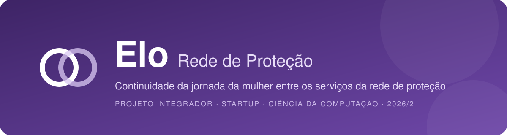

<br>


**Uma camada de continuidade entre os serviços da rede de proteção à mulher.**

[](https://diegoomarcelo.github.io/elo-rede-de-protecao/)

[Como funciona](#-como-funciona) ·
[Telas](#-telas-do-protótipo) ·
[Funcionalidades](#-funcionalidades) ·
[Como executar](#-como-executar) ·
[Arquitetura](#-arquitetura-do-código)

</div>

---

> [!IMPORTANT]
> Protótipo acadêmico. Todos os nomes, casos, endereços e telefones de serviços são **fictícios**. Os únicos dados reais são os telefones públicos de ajuda (180, 190, 197 e 192).

## 💡 Sobre

Quando uma mulher em situação de violência é encaminhada de um serviço da rede de proteção para outro, o serviço de origem nem sempre sabe se ela chegou, ela nem sempre sabe para onde ir e, muitas vezes, precisa contar a mesma história de novo.

O **Elo** organiza essa passagem entre serviços. Ele **não substitui** os sistemas que já existem (SEI, e-SUS, PJe, SUAS): o conteúdo de cada atendimento continua onde está, e o Elo registra apenas o encaminhamento, a confirmação, o atendimento e o retorno.

O protótipo mostra a mesma jornada vista por três públicos: **a mulher atendida**, **os profissionais da rede** e **a gestão da rede**.

---

## 🔄 Como funciona

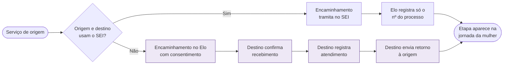

### Ciclo de vida de um encaminhamento

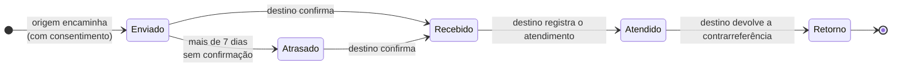

---

## 👥 Perfis de acesso

| Perfil | No protótipo | O que vê e faz |
|:--|:--|:--|
| 👩 **Mulher atendida** | Mariana Costa | Próximo passo, encaminhamentos, linha do tempo e quem acessou suas informações. |
| 🏛️ **Casa da Mulher Brasileira** | Ana Souza, psicóloga | Referência do caso; recebe, encaminha e acompanha casos. |
| 🤝 **Comitê de Águas Claras** | Carla Nunes, articuladora | Usa o SEI; registra no Elo só as passagens para serviços fora do SEI. |
| 🩺 **UBS 1 Águas Claras** | Paula Lima, enfermeira | Porta de entrada pela saúde. |
| 🧾 **CREAS Águas Claras** | Lucas Pereira, assistente social | Confirma recebimento, registra atendimento e devolve retorno. |
| 📊 **Gestão da rede** | Coordenação da rede | Números agregados, sem nomes nem conteúdo dos atendimentos. |

## 🧭 Princípios

| Princípio | Na prática |
|:--|:--|
| **Complementar, não substituir** | Onde os serviços já se comunicam pelo SEI, o Elo só registra a passagem. |
| **Só o necessário** | Cada serviço vê apenas o que registrou ou o que foi compartilhado com ele. |
| **Com autorização da mulher** | Nenhum encaminhamento é enviado sem o consentimento dela. |
| **Transparência** | Todo acesso fica registrado e visível para a mulher. |
| **Linguagem simples** | A tela dela fala em "para onde ir" e "o que levar". |
| **Segurança** | O botão "Sair rápido" troca a tela por uma lista de compras. |

---

## 📸 Telas do protótipo

### Tela inicial

<p align="center">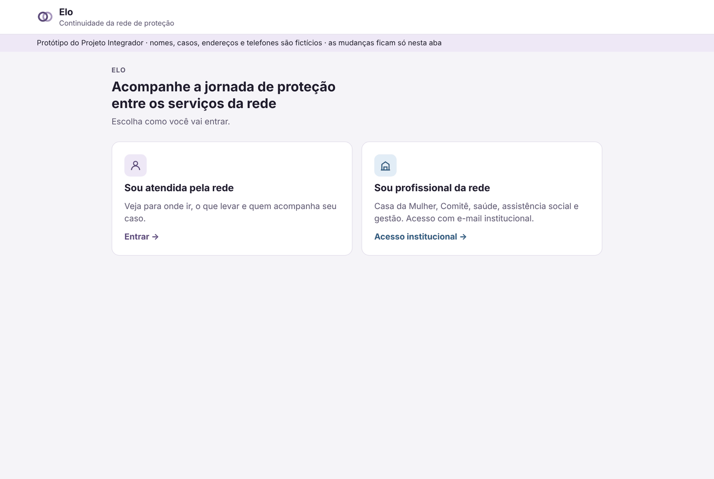</p>

A entrada separa os dois públicos desde o início. A mulher entra pela própria jornada; o profissional entra com o e-mail institucional e vê a tela do seu serviço.

### Visão da mulher atendida

<p align="center">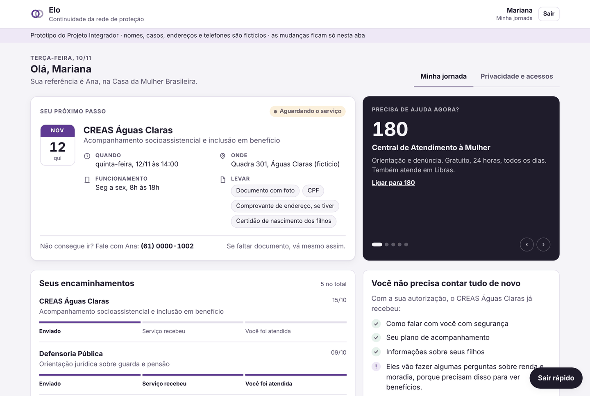</p>

Pensamos esta tela para responder às perguntas que mais pesam para ela: **para onde ir, quando, o que levar e com quem falar**. À direita, um carrossel com telefones de ajuda e o bloco *"Você não precisa contar tudo de novo"*, que mostra o que o CREAS já recebeu, com a autorização dela, e avisa o que ainda vão perguntar por causa da função do serviço.

<table>
<tr>
<td width="50%" valign="top">
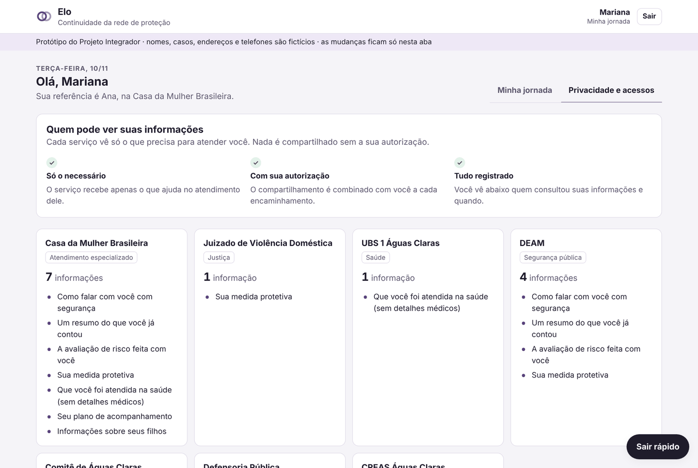
<p><b>Privacidade e acessos.</b> Cada serviço aparece com as informações a que tem acesso, e a mulher vê os últimos acessos ao seu caso.</p>
</td>
<td width="50%" valign="top">
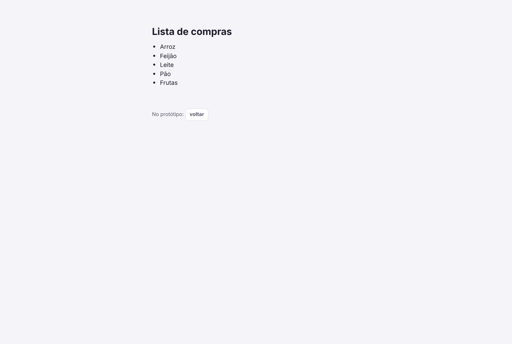
<p><b>Sair rápido.</b> Em um clique, a tela e o título da aba viram uma lista de compras. Nada indica o que ela estava vendo.</p>
</td>
</tr>
</table>

### Visão do profissional da rede

<p align="center">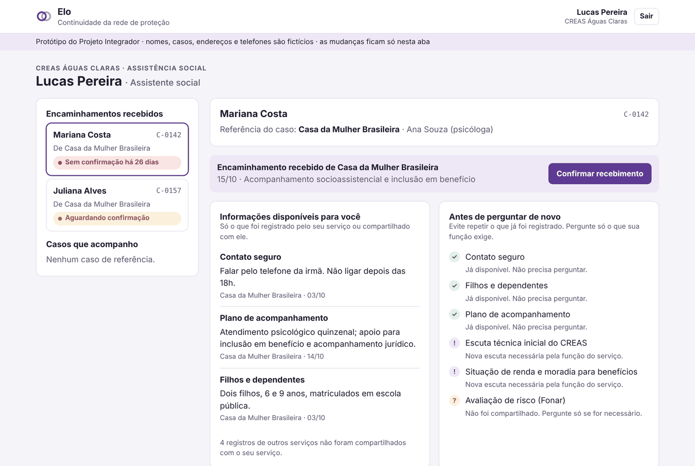</p>

O profissional vê os encaminhamentos recebidos e os casos que acompanha. Quando um encaminhamento fica parado por mais de 7 dias, o alerta aparece para quem precisa agir.

<table>
<tr>
<td width="50%" valign="top">
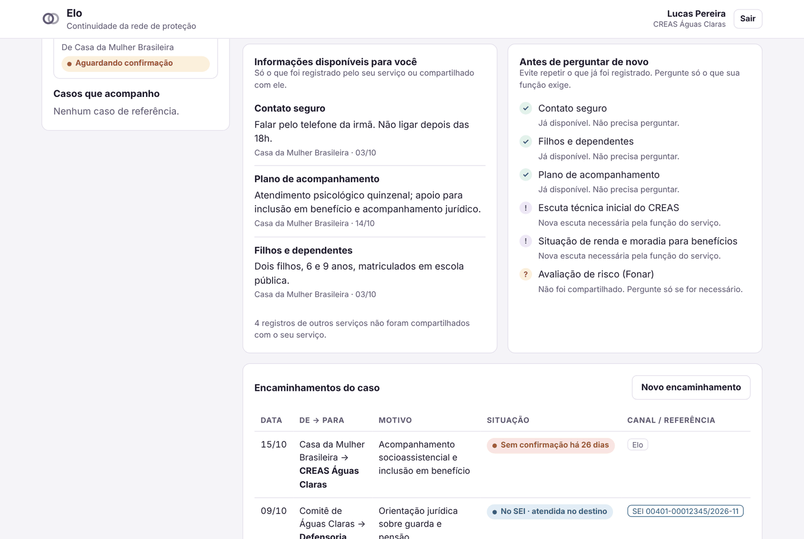
<p><b>Antes de perguntar de novo.</b> ✓ já disponível · <b>!</b> o serviço precisa perguntar pela própria função · <b>?</b> não compartilhado, só perguntar se necessário.</p>
</td>
<td width="50%" valign="top">
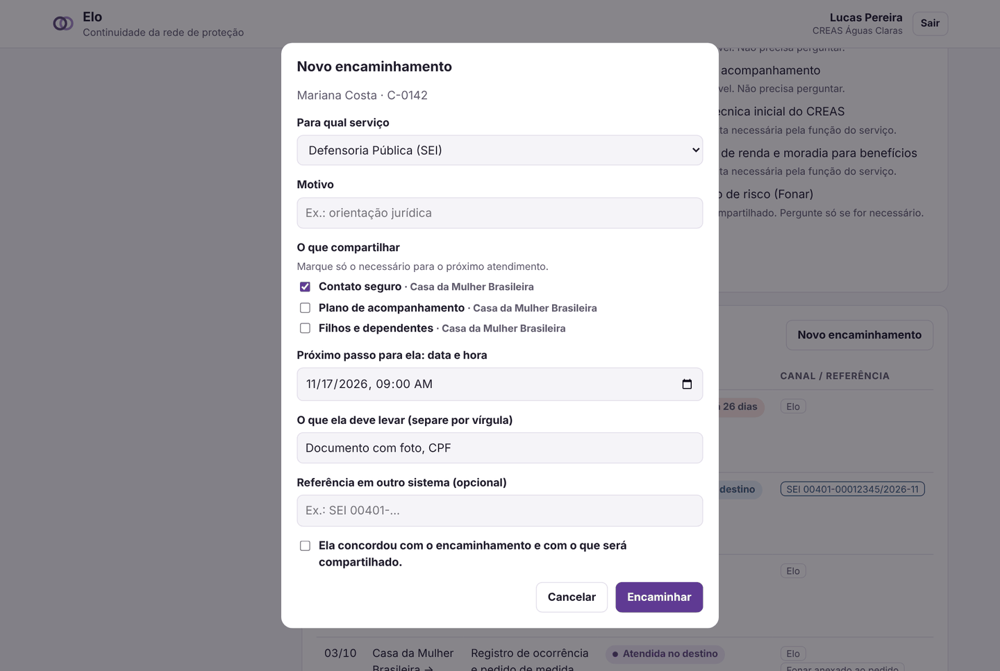
<p><b>Novo encaminhamento.</b> Destino, motivo, o que compartilhar, próximo passo e o consentimento da mulher. Se origem e destino usam o SEI, o número do processo passa a ser obrigatório.</p>
</td>
</tr>
</table>

### Serviço que já usa o SEI

<p align="center">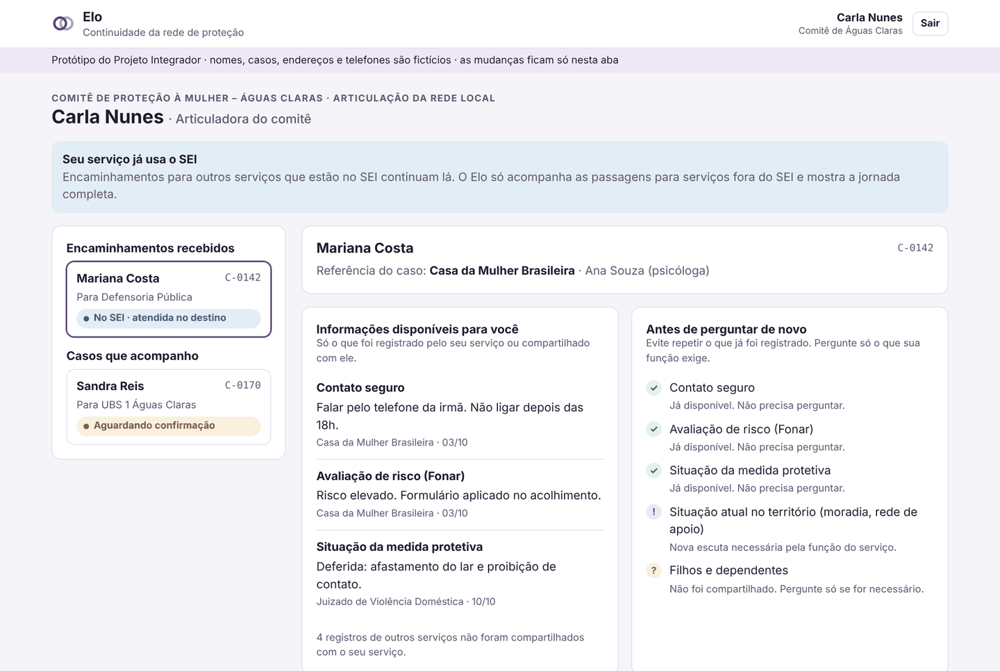</p>

A tela do Comitê mostra a decisão de **complementar, e não substituir**: os encaminhamentos pelo SEI continuam lá, e o Elo apenas registra a etapa para a jornada ficar completa.

### Gestão da rede

<p align="center">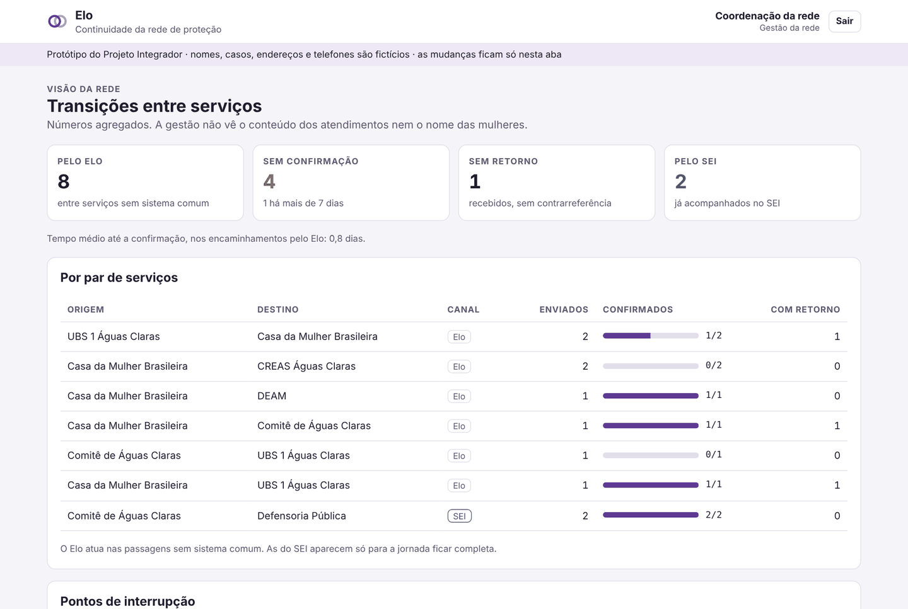</p>

A gestão acompanha onde os encaminhamentos ficam parados, quantos têm retorno e quanto tempo levam para ser confirmados, **sempre com números agregados**, sem nomes nem conteúdo dos atendimentos.

---

## ✅ Funcionalidades

| ID | Funcionalidade | Perfil | Concluída |
|:--|:--|:--|:-:|
| F01 | Encaminhar com consentimento e escolha do que compartilhar | Profissional | 06/11 |
| F02 | Confirmar recebimento, registrar atendimento e enviar retorno | Profissional | 06/11 |
| F03 | Painel "Antes de perguntar de novo" | Profissional | 07/11 |
| F04 | Próximo passo da mulher: quando, onde, horário e o que levar | Mulher | 05/11 |
| F05 | Andamento dos encaminhamentos e linha do tempo da jornada | Mulher | 05/11 |
| F06 | Bloco "Você não precisa contar tudo de novo" | Mulher | 05/11 |
| F07 | Registro da passagem pelo SEI (só o número do processo) | Profissional | 07/11 |
| F08 | Registro de acessos visível para a mulher | Mulher | 08/11 |
| F09 | Botão "Sair rápido" com tela disfarce | Mulher | 08/11 |
| F10 | Alerta de encaminhamento sem confirmação há mais de 7 dias | Profissional | 08/11 |
| F11 | Indicadores agregados e pontos de interrupção | Gestão | 09/11 |
| F12 | Telefones de ajuda (180, 190, 197, WhatsApp PCDF, 192) | Mulher | 09/11 |

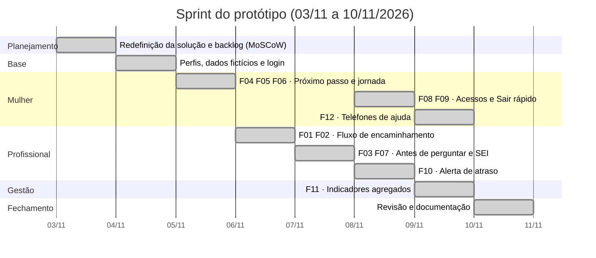

---

## 🚀 Como executar

**Online:** acesse **[https://diegoomarcelo.github.io/elo-rede-de-protecao/](https://diegoomarcelo.github.io/elo-rede-de-protecao/)**.

**Localmente:** não precisa de instalação nem servidor, basta abrir o `index.html` no navegador.

```bash
git clone <url-deste-repositório>
cd elo-rede-de-protecao
# abra o index.html no navegador
```

| Acesso de teste | |
|:--|:--|
| E-mail | `teste@teste.com` |
| Senha | `123456` |

A mesma credencial vale para todos os perfis. No login institucional, o serviço escolhido define a tela que abre.

> [!NOTE]
> Os dados ficam só na memória da aba: ao recarregar, tudo volta ao estado inicial. A data "de hoje" do protótipo é fixa em **10/11/2026**, para os prazos e alertas serem sempre os mesmos.

---

## 🧱 Arquitetura do código

O protótipo é uma página web em **HTML, CSS e JavaScript puros**, sem frameworks nem build. O código foi separado por responsabilidade, e cada arquivo tem um cabeçalho explicando o que faz.

```text
elo-rede-de-protecao/
├── index.html                    # Esqueleto da página e ordem de carregamento
├── README.md
├── css/
│   ├── 01-base.css               # Reset, tokens de cor (claro/escuro), tipografia
│   ├── 02-cabecalho.css          # Barra do topo: marca e usuário logado
│   ├── 03-login.css              # Tela inicial e logins
│   ├── 04-componentes.css        # Cards, botões, pílulas de status, etiquetas
│   ├── 05-mulher.css             # Tela da mulher, carrossel, privacidade, Sair rápido
│   ├── 06-profissional.css       # Caixa de casos, alertas, checklist, tabelas
│   ├── 07-gestao.css             # Indicadores e barras de progresso
│   └── 08-modal.css              # Modais, formulários e toast
├── js/
│   ├── 01-dados.js               # Serviços, perfis, casos e auditoria (fictícios)
│   ├── 02-estado.js              # Estado da interface
│   ├── 03-utilidades.js          # Datas, permissões, status, toast
│   ├── 04-tela-login.js          # Tela inicial, logins e validação
│   ├── 05-tela-mulher.js         # Minha jornada e Privacidade
│   ├── 06-carrossel-ajuda.js     # Telefones de ajuda
│   ├── 07-tela-neutra.js         # Tela disfarce do Sair rápido
│   ├── 08-tela-profissional.js   # Caixa de casos e detalhe do caso
│   ├── 09-tela-gestao.js         # Indicadores agregados
│   ├── 10-modais.js              # Atendimento, retorno e novo encaminhamento
│   ├── 11-render.js              # Decide qual tela desenhar
│   ├── 12-eventos.js             # Cliques, formulários e teclado
│   └── 13-main.js                # Primeira renderização
└── docs/
    └── img/                      # Banner e capturas de tela
```

### Como as peças se conectam

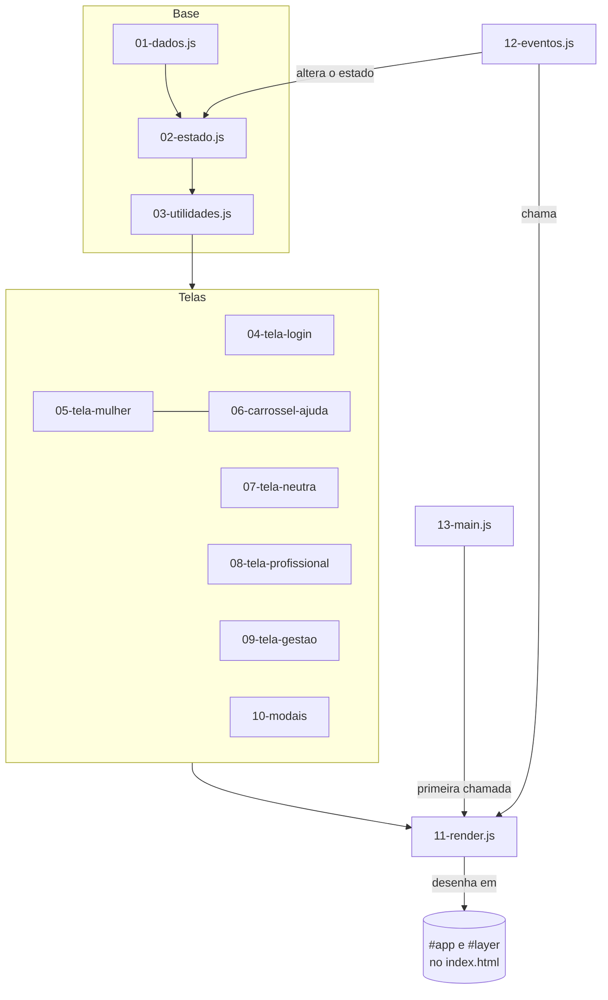

**Como funciona o ciclo da interface:**

1. Todo o estado da tela fica em um único objeto, `state` (`02-estado.js`): quem está logado, qual tela, qual caso está selecionado, qual modal está aberto.
2. Cada tela é uma função que **devolve HTML em texto** a partir do estado e dos dados (`viewMulher`, `viewProf`, `viewGestao`…).
3. A função `render()` (`11-render.js`) escolhe a tela certa e a desenha em `#app`; os modais vão para `#layer`.
4. Um único ouvinte de cliques (`12-eventos.js`) identifica a ação pelos atributos `data-*` dos botões, altera o estado e chama `render()` de novo.

> [!IMPORTANT]
> A **ordem dos `<script>`** no `index.html` importa: cada arquivo usa o que os anteriores definiram. Os scripts são comuns (não módulos), por isso a página funciona abrindo o arquivo direto, sem servidor.

### Atributos de ação usados nos botões

| Atributo | Para que serve | Exemplo |
|:--|:--|:--|
| `data-go` | Navegar entre telas antes do login | `data-go="login-mulher"` |
| `data-tab` | Trocar de aba na tela da mulher | `data-tab="privacidade"` |
| `data-case` | Selecionar um caso na caixa do profissional | `data-case="C-0142"` |
| `data-act` | Executar uma ação | `confirm`, `newref`, `exit`, `logout` |
| `data-help` | Navegar no carrossel de ajuda | `data-help="next"` |

---

## 💾 Modelo de dados

Os dados ficam em `js/01-dados.js`. A estrutura foi pensada para já refletir o princípio "só o necessário".

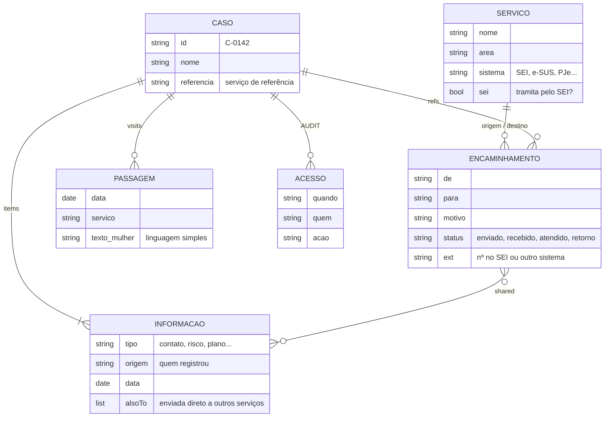

**Regra de visibilidade** (`visibleItems` em `03-utilidades.js`): um serviço vê uma informação somente se

1. **ele mesmo** a registrou; ou
2. ela foi **enviada diretamente** para ele (`alsoTo`); ou
3. ela foi **compartilhada** em um encaminhamento que ele recebeu (`shared`).

Cada informação tem dois textos: o rótulo técnico para o profissional (`KINDS`) e a versão em linguagem simples para a mulher (`KINDS_HER`).

---

## ♿ Acessibilidade e segurança

**Acessibilidade**

- 🔤 Fonte **Atkinson Hyperlegible**, criada para alta legibilidade, nos textos.
- 🌗 **Modo escuro** automático, seguindo a preferência do sistema operacional.
- 📱 Layout **responsivo**, que funciona no celular e respeita as áreas seguras (notch e barras).
- ⌨️ Navegação por **teclado**, com foco visível e tecla `Esc` para fechar modais.
- 🎞️ O carrossel **pausa** com o mouse em cima ou com foco, e respeita a preferência de **movimento reduzido**.
- 🔊 Atributos de acessibilidade (`aria-*`) para leitores de tela no carrossel e nos ícones.

**Segurança da usuária**

- 🚪 **Sair rápido** sempre visível: troca a tela e o título da aba por uma lista de compras.
- 🔐 **Consentimento obrigatório** antes de qualquer encaminhamento.
- 👁️ **Registro de acessos** visível para a própria mulher.
- 📉 A **gestão** só vê números agregados.
- 🧾 O Elo **não copia** prontuários, relatos completos nem processos.

---

## 👤 Autor

Protótipo desenvolvido por **Diego Marcelo**.

## 🤖 Uso de Inteligência Artificial

Utilizei ferramentas de Inteligência Artificial como apoio na depuração (debug) do código e na estruturação deste README. Todo o conteúdo foi revisado por mim.

---

<div align="center">

<sub>Elo – Rede de Proteção · Protótipo acadêmico com dados fictícios</sub><br>
<sub>Em situação de violência, ligue <b>180</b> (Central de Atendimento à Mulher) ou <b>190</b> em emergência.</sub>

</div>
