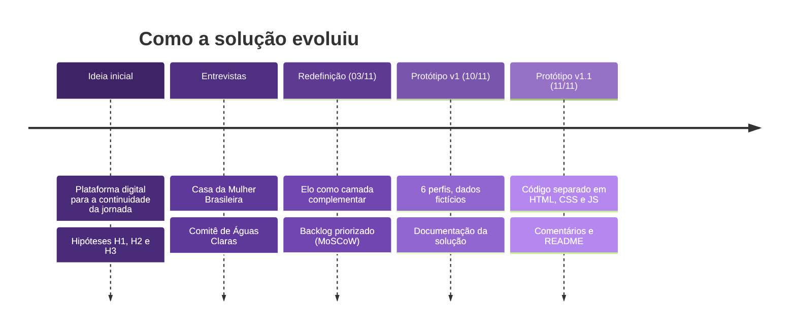
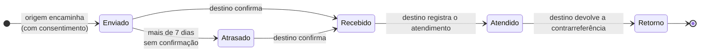
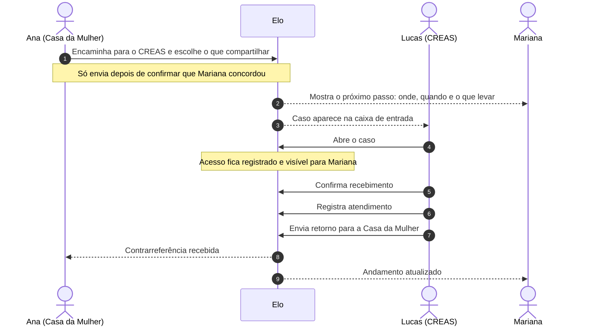
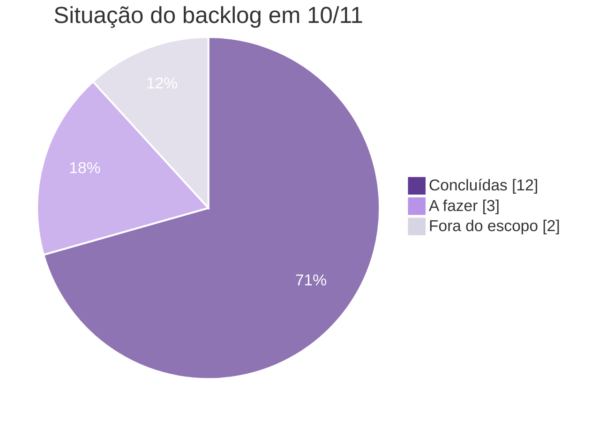
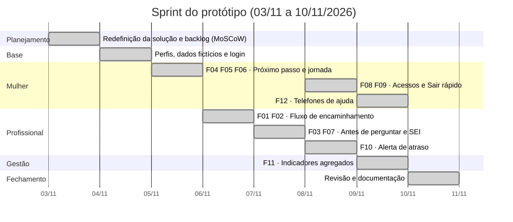
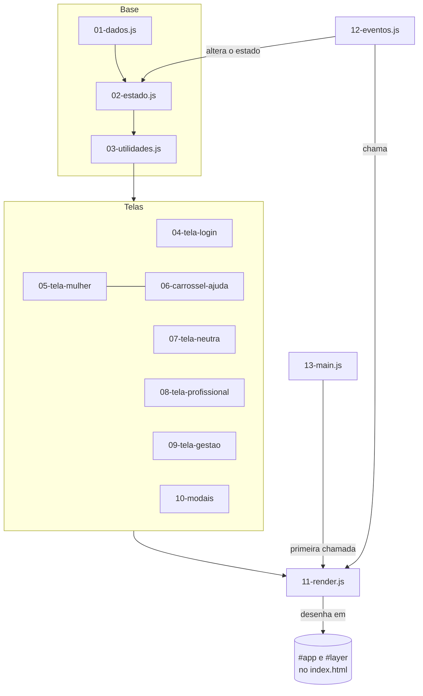
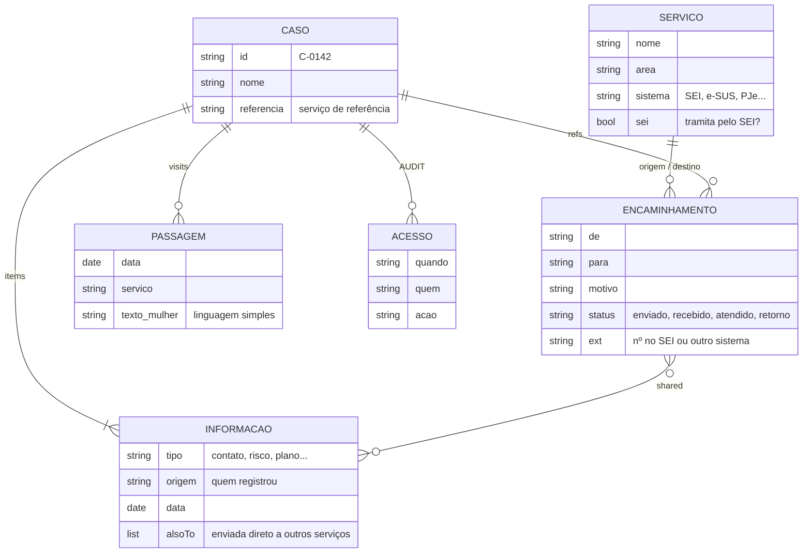

<div align="center">


<br>


**Uma camada de continuidade entre os serviços da rede de proteção à mulher.**
O Elo organiza a passagem da mulher de um serviço para outro, sem substituir os sistemas que já funcionam.

[Sobre](#-sobre-o-projeto) ·
[Telas](#-telas-do-protótipo) ·
[MVP](#-escopo-do-mvp) ·
[Backlog](#-backlog-e-sprint) ·
[Como executar](#-como-executar) ·
[Arquitetura](#-arquitetura-do-código)

</div>

---

> [!IMPORTANT]
> Este repositório contém um **protótipo acadêmico**. Todos os nomes, casos, endereços e telefones de serviços são **fictícios**. Os únicos dados reais são os telefones públicos de ajuda (180, 190, 197 e 192).

## 📑 Sumário

1. [Sobre o projeto](#-sobre-o-projeto)
2. [Do campo ao protótipo](#-do-campo-ao-protótipo)
3. [Como o Elo funciona](#-como-o-elo-funciona)
4. [Perfis de acesso](#-perfis-de-acesso)
5. [Princípios de design](#-princípios-de-design)
6. [Telas do protótipo](#-telas-do-protótipo)
7. [Escopo do MVP](#-escopo-do-mvp)
8. [Backlog e sprint](#-backlog-e-sprint)
9. [Como executar](#-como-executar)
10. [Roteiro de demonstração](#-roteiro-de-demonstração)
11. [Arquitetura do código](#-arquitetura-do-código)
12. [Modelo de dados](#-modelo-de-dados)
13. [Acessibilidade e segurança](#-acessibilidade-e-segurança)
14. [Limitações e próximos passos](#-limitações-e-próximos-passos)
15. [Equipe](#-equipe)
16. [Declaração de uso de IA](#-declaração-de-uso-de-inteligência-artificial)

---

## 💡 Sobre o projeto

O **Elo** é o protótipo da nossa startup no Projeto Integrador da disciplina **Startup do Zero** (Ciência da Computação, 2026/2). O problema que escolhemos é a **continuidade da jornada da mulher em situação de violência entre os serviços da rede de proteção**: saúde, assistência social, segurança pública, justiça e serviços especializados.

Quando uma mulher é encaminhada de um serviço para outro, muitas vezes:

- o serviço de origem **não sabe se ela chegou** ao destino;
- a mulher **não sabe exatamente para onde ir, quando e o que levar**;
- ela precisa **contar de novo** uma história que já contou;
- a gestão da rede **não enxerga onde os encaminhamentos ficam parados**.

O Elo não pretende ser "mais um sistema". Ele é uma **camada complementar**: registra e acompanha a passagem entre serviços, enquanto o conteúdo de cada atendimento continua no sistema de cada instituição (SEI, e-SUS, PJe, registro SUAS, sistema policial).

---

## 🔎 Do campo ao protótipo

Antes de desenhar qualquer tela, fomos a campo. Entrevistamos profissionais da **Casa da Mulher Brasileira** e do **Comitê de Proteção à Mulher de Águas Claras** para testar três hipóteses.

| Hipótese | O que acreditávamos | Resultado | O que aprendemos | Como o protótipo responde |
|:--|:--|:--|:--|:--|
| **H1 · Continuidade** | A rede é desconectada e a mulher se perde entre os serviços. | 🟡 Parcialmente confirmada. Na Casa da Mulher o retorno varia entre serviços; no Comitê, o SEI e o contato direto atendem. | A rede não é totalmente desconectada. | O fluxo de confirmação e retorno só é usado nas passagens **sem sistema comum**. As passagens pelo SEI são apenas registradas. |
| **H2 · Repetição** | A mulher repete sua história em cada serviço. | 🟡 Parcialmente confirmada. As informações nem sempre acompanham a mulher (ex.: Saúde → Casa da Mulher). | Algumas perguntas são **necessárias** pela função do serviço; o foco são as repetições evitáveis. | Painel **"Antes de perguntar de novo"** para o profissional e bloco **"Você não precisa contar tudo de novo"** para a mulher. |
| **H3 · Integração** | Integrar os sistemas resolveria o problema. | 🔵 Ainda em validação. A Casa da Mulher vê valor; o Comitê já é atendido pelo SEI; o UNA integra, mas com dificuldades. | Não basta criar outro sistema. | O Elo guarda **só o número do registro** no sistema de origem e não copia prontuários nem processos. |

> [!NOTE]
> **Decisão que tomamos:** criar uma solução complementar para os pontos em que serviços e sistemas ainda apresentam dificuldades de conexão, **sem substituir o que já funciona**.

### Evolução da solução



---

## ⚙️ Como o Elo funciona

O comportamento do Elo depende de **onde a passagem acontece**:


### Ciclo de vida de um encaminhamento



### Exemplo: o caso da Mariana

A persona **Mariana Costa** (item 3.8 do nosso documento) foi atendida na UBS, acolhida na Casa da Mulher Brasileira e agora foi encaminhada para o CREAS.



---

## 👥 Perfis de acesso

| Perfil | Quem é no protótipo | O que vê e faz |
|:--|:--|:--|
| 👩 **Mulher atendida** | Mariana Costa | Próximo passo, encaminhamentos, linha do tempo, quem acompanha o caso e quem acessou suas informações. |
| 🏛️ **Casa da Mulher Brasileira** | Ana Souza, psicóloga | Referência do caso da Mariana; recebe, encaminha e acompanha casos. |
| 🤝 **Comitê de Proteção à Mulher – Águas Claras** | Carla Nunes, articuladora | Serviço que já usa o SEI; registra no Elo só as passagens para serviços fora do SEI. |
| 🩺 **UBS 1 Águas Claras** | Paula Lima, enfermeira | Porta de entrada pela saúde; encaminha para a Casa da Mulher. |
| 🧾 **CREAS Águas Claras** | Lucas Pereira, assistente social | Serviço de destino que confirma recebimento, registra atendimento e devolve retorno. |
| 📊 **Gestão da rede** | Coordenação da rede | Números agregados das transições, sem nomes nem conteúdo dos atendimentos. |

### Relação com os sistemas existentes

| Situação | O que acontece no Elo |
|:--|:--|
| Passagem entre dois serviços que usam o **SEI** | O encaminhamento tramita no SEI. O Elo guarda só o número do processo e mostra a etapa na jornada. |
| Passagem envolvendo um serviço **fora do SEI** | O Elo conduz o fluxo completo de confirmação, atendimento e retorno. |
| **Registros próprios** de cada serviço (e-SUS, PJe, SUAS, sistema policial) | Continuam onde estão. O Elo pode guardar apenas o número de referência. |

> [!NOTE]
> No protótipo, a indicação de quais serviços usam o SEI é uma configuração de exemplo (`sei: true` em `js/01-dados.js`). O Comitê de Águas Claras usa o SEI conforme a entrevista; a Defensoria Pública aparece no SEI apenas como suposição, que ainda vamos confirmar.

---

## 🧭 Princípios de design

| # | Princípio | Na prática |
|:-:|:--|:--|
| 1 | **Complementar, não substituir** | Onde os serviços já se comunicam bem (como pelo SEI), o Elo só registra a passagem. |
| 2 | **Só o necessário** | Cada serviço vê apenas o que registrou ou o que foi compartilhado com ele. |
| 3 | **Com autorização da mulher** | Nenhum encaminhamento é enviado sem confirmar que ela concordou. |
| 4 | **Repetição só quando necessária** | O sistema separa o que já foi registrado do que o serviço precisa perguntar. |
| 5 | **Transparência** | Todo acesso fica registrado, e a mulher vê quem consultou suas informações. |
| 6 | **Linguagem simples** | A tela dela fala em "para onde ir" e "o que levar", sem termos técnicos. |
| 7 | **Segurança em primeiro lugar** | O botão "Sair rápido" troca a tela por uma lista de compras comum. |

---

## 🖼️ Telas do protótipo

### Tela inicial

<p align="center"></p>

A entrada separa os dois públicos desde o início. A mulher entra pela própria jornada; o profissional entra com o e-mail institucional e vê a tela do seu serviço.

### Visão da mulher atendida

<p align="center"></p>

Pensamos esta tela para responder às perguntas que mais pesam para ela: **para onde ir, quando, o que levar e com quem falar**. À direita, um carrossel com telefones de ajuda e o bloco *"Você não precisa contar tudo de novo"*, que mostra o que o CREAS já recebeu, com a autorização dela, e avisa o que ainda vão perguntar por causa da função do serviço (**H2**).

<table>
<tr>
<td width="50%" valign="top">

<p><b>Privacidade e acessos.</b> Cada serviço aparece com as informações a que tem acesso, e a mulher vê os últimos acessos ao seu caso.</p>
</td>
<td width="50%" valign="top">

<p><b>Sair rápido.</b> Em um clique, a tela e o título da aba viram uma lista de compras. Nada indica o que ela estava vendo.</p>
</td>
</tr>
</table>

### Visão do profissional da rede

<p align="center"></p>

O profissional do CREAS vê os encaminhamentos recebidos e os casos que acompanha. Quando um encaminhamento fica parado por mais de 7 dias, o alerta aparece para quem precisa agir (**H1**).

<table>
<tr>
<td width="50%" valign="top">

<p><b>Antes de perguntar de novo.</b> ✓ já disponível · <b>!</b> o serviço precisa perguntar pela própria função · <b>?</b> não compartilhado, só perguntar se necessário (<b>H2</b>).</p>
</td>
<td width="50%" valign="top">

<p><b>Novo encaminhamento.</b> Destino, motivo, o que compartilhar, próximo passo e o consentimento da mulher. Se origem e destino usam o SEI, o número do processo passa a ser obrigatório.</p>
</td>
</tr>
</table>

### Serviço que já usa o SEI

<p align="center"></p>

A tela do Comitê mostra a decisão de **complementar, e não substituir**: os encaminhamentos pelo SEI continuam lá, e o Elo apenas registra a etapa para a jornada ficar completa (**H3**).

### Gestão da rede

<p align="center"></p>

A gestão acompanha onde os encaminhamentos ficam parados, quantos têm retorno e quanto tempo levam para ser confirmados, **sempre com números agregados**, sem nomes nem conteúdo dos atendimentos.

---

## 🎯 Escopo do MVP

Definimos o MVP como a menor versão do Elo capaz de testar a nossa hipótese central:

> **Quando a passagem entre dois serviços sem sistema comum é registrada, confirmada e devolvida, a mulher deixa de "se perder" entre serviços e precisa repetir menos a sua história.**

Nesta etapa, o protótipo navegável é o nosso **MVP de validação**: ele executa o fluxo essencial de ponta a ponta, com dados fictícios, para que profissionais e usuárias usem as telas e nos deem retorno.

| ✅ Dentro do MVP | ⛔ Fora do MVP (por enquanto) | Por que deixamos de fora |
|:--|:--|:--|
| Encaminhamento com consentimento e escolha do que compartilhar | Integração automática com SEI, e-SUS e PJe | Esses sistemas já funcionam; integrá-los exige acordos institucionais que não cabem nesta fase. |
| Confirmação, registro de atendimento e retorno (contrarreferência) | Armazenar relatos completos ou prontuários | Contraria o princípio "só o necessário" e aumenta o risco de exposição de dados sensíveis. |
| Tela da mulher: próximo passo, andamento e quem acompanha | Cadastro feito pela própria mulher | O acesso é criado junto com o serviço que a atende, por segurança. |
| "Antes de perguntar de novo" e "Você não precisa contar tudo de novo" | Aplicativo nativo para celular | A versão web responsiva já funciona no celular e é mais rápida de testar. |
| Registro da passagem pelo SEI (só o número do processo) | SMS e e-mail automáticos | Primeiro precisamos validar o fluxo; o canal de aviso vem depois. |
| Registro de acessos, "Sair rápido" e indicadores básicos de gestão | Painéis analíticos avançados | Os indicadores básicos já permitem testar se a gestão vê valor. |

> [!TIP]
> **Para o MVP piloto (próxima versão):** login real com cadastro feito pelo serviço, banco de dados com hospedagem segura, adequação à LGPD (dados sensíveis, consentimento e retenção) e um piloto com poucos serviços de Águas Claras.

---

## 📋 Backlog e sprint

Montamos o backlog em **03/11**, logo depois de redefinir a solução, e o desenvolvemos em uma sprint até **10/11**. Priorizamos pelo método **MoSCoW**:

| Sigla | Significado |
|:-:|:--|
| 🟣 **M** | *Must* — obrigatório |
| 🔵 **S** | *Should* — importante |
| ⚪ **C** | *Could* — desejável |
| ⚫ **W** | *Won't* — não fará agora |

### Backlog priorizado

| ID | Funcionalidade | Perfil | Origem | Prior. | Entrou | Fim | Situação |
|:--|:--|:--|:--|:-:|:-:|:-:|:--|
| F01 | Encaminhar com consentimento e escolha do que compartilhar | Profissional | H1, H2 | 🟣 M | 03/11 | 06/11 | ✅ Concluída |
| F02 | Confirmar recebimento, registrar atendimento e enviar retorno | Profissional | H1 | 🟣 M | 03/11 | 06/11 | ✅ Concluída |
| F03 | "Antes de perguntar de novo" (já registrado × precisa perguntar) | Profissional | H2 | 🟣 M | 03/11 | 07/11 | ✅ Concluída |
| F04 | Próximo passo da mulher: quando, onde, horário e o que levar | Mulher | H1 | 🟣 M | 03/11 | 05/11 | ✅ Concluída |
| F05 | Andamento dos encaminhamentos e linha do tempo da jornada | Mulher | H1 | 🟣 M | 03/11 | 05/11 | ✅ Concluída |
| F06 | "Você não precisa contar tudo de novo" | Mulher | H2 | 🟣 M | 03/11 | 05/11 | ✅ Concluída |
| F07 | Registro da passagem pelo SEI (só número do processo) | Profissional | H3 | 🟣 M | 03/11 | 07/11 | ✅ Concluída |
| F08 | Registro de acessos visível para a mulher | Mulher / todos | Transparência | 🟣 M | 03/11 | 08/11 | ✅ Concluída |
| F09 | Botão "Sair rápido" com tela disfarce | Mulher | Segurança | 🟣 M | 04/11 | 08/11 | ✅ Concluída |
| F10 | Alerta de encaminhamento sem confirmação há mais de 7 dias | Profissional | H1 | 🔵 S | 03/11 | 08/11 | ✅ Concluída |
| F11 | Indicadores agregados e pontos de interrupção | Gestão | H1 | 🔵 S | 03/11 | 09/11 | ✅ Concluída |
| F12 | Telefones de ajuda (180, 190, 197, WhatsApp PCDF, 192) | Mulher | Segurança | 🔵 S | 05/11 | 09/11 | ✅ Concluída |
| F13 | Login real e cadastro feito pelo serviço | Todos | MVP piloto | 🟣 M | 03/11 | — | 🕓 A fazer |
| F14 | Banco de dados e hospedagem segura (LGPD) | Todos | MVP piloto | 🟣 M | 03/11 | — | 🕓 A fazer |
| F15 | Avisos por e-mail/SMS ao serviço de destino | Profissional | H1 | ⚪ C | 07/11 | — | 🕓 A fazer |
| F16 | Integração automática com SEI, e-SUS e PJe | — | H3 | ⚫ W | 03/11 | — | 🚫 Fora do escopo |
| F17 | Aplicativo nativo | Mulher | — | ⚫ W | 03/11 | — | 🚫 Fora do escopo |



### Linha do tempo da sprint



<details>
<summary><b>📅 Histórico dia a dia</b></summary>

| Data | O que fizemos | Itens |
|:--|:--|:--|
| **03/11 (ter)** | Redefinimos a solução como camada complementar, criamos o backlog e priorizamos as funcionalidades pelo MoSCoW. | F01 a F17 (entrada) |
| **04/11 (qua)** | Montamos a base do protótipo: perfis de acesso, dados fictícios a partir da persona Mariana e telas de login. Incluímos o "Sair rápido" no backlog por segurança. | Base · F09 (entrada) |
| **05/11 (qui)** | Construímos a tela da mulher: próximo passo, andamento, linha do tempo e "Você não precisa contar tudo de novo". Incluímos os telefones de ajuda no backlog. | F04, F05, F06 · F12 (entrada) |
| **06/11 (sex)** | Construímos o fluxo do profissional: encaminhar com consentimento, confirmar recebimento, registrar atendimento e enviar retorno. | F01, F02 |
| **07/11 (sáb)** | Criamos o painel "Antes de perguntar de novo" e a regra do SEI. Registramos os avisos por e-mail/SMS como melhoria futura. | F03, F07 · F15 (entrada) |
| **08/11 (dom)** | Implementamos o registro de acessos, o "Sair rápido" e o alerta de encaminhamento parado há mais de 7 dias. | F08, F09, F10 |
| **09/11 (seg)** | Construímos a tela de gestão com indicadores agregados e o carrossel de telefones de ajuda. | F11, F12 |
| **10/11 (ter)** | Revisamos todas as telas, conferimos os telefones públicos de ajuda e escrevemos a documentação da solução. | Revisão e documentação |

</details>

📌 Quadro completo no Trello: **[inserir link]**

---

## ▶️ Como executar

O protótipo não precisa de instalação, servidor nem internet (a internet só é usada para carregar as fontes).

```bash
# 1. Clone o repositório
git clone [inserir link do repositório]

# 2. Entre na pasta
cd elo-rede-de-protecao

# 3. Abra o index.html no navegador (ou dê dois cliques no arquivo)
```

> [!TIP]
> Se preferir rodar com um servidor local: `python3 -m http.server 8000` e acesse `http://localhost:8000`.

### Acesso de teste

| Campo | Valor |
|:--|:--|
| E-mail | `teste@teste.com` |
| Senha | `123456` |

A mesma credencial vale para todos os perfis. No login institucional, o **serviço escolhido** define a tela que abre (Casa da Mulher, Comitê, UBS, CREAS ou Gestão).

> [!WARNING]
> Os dados ficam só na memória da aba do navegador. Ao recarregar a página, tudo volta ao estado inicial. A data "de hoje" do protótipo é fixa em **10/11/2026**, para os prazos e alertas ficarem sempre iguais na demonstração.

---

## 🎬 Roteiro de demonstração

Roteiro de cerca de 5 minutos, usado na apresentação de 12/11:

| # | Tela | O que mostrar | Funcionalidades |
|:-:|:--|:--|:--|
| 1 | Tela inicial | As duas entradas: mulher atendida e profissional da rede. | — |
| 2 | Mariana · Minha jornada | Próximo passo no CREAS, o que levar, andamento e "Você não precisa contar tudo de novo". | F04, F05, F06 |
| 3 | Mariana · Privacidade | O que cada serviço pode ver e quem consultou as informações dela. | F08 |
| 4 | Sair rápido | A tela vira uma lista de compras em um clique. | F09 |
| 5 | CREAS · Lucas | Alerta de encaminhamento parado, confirmação de recebimento e "Antes de perguntar de novo". | F02, F03, F10 |
| 6 | Novo encaminhamento | Escolha do que compartilhar e consentimento da mulher. | F01 |
| 7 | Comitê · Carla | Serviço que já usa o SEI: o Elo só registra a passagem. | F07 |
| 8 | Gestão da rede | Indicadores agregados e pontos de interrupção, sem nomes. | F11 |

---

## 🏗️ Arquitetura do código

O protótipo é uma página web em **HTML, CSS e JavaScript puros**, sem frameworks nem build. O código foi separado por responsabilidade, e cada arquivo tem um cabeçalho explicando o que faz.

```text
elo-rede-de-protecao/
├── index.html                    # Esqueleto da página e ordem de carregamento
├── README.md                     # Este documento
├── css/
│   ├── 01-base.css               # Reset, tokens de cor (claro/escuro), tipografia
│   ├── 02-cabecalho.css          # Barra do topo: marca e usuário logado
│   ├── 03-login.css              # Tela inicial e logins
│   ├── 04-componentes.css        # Cards, botões, pílulas de status, etiquetas
│   ├── 05-mulher.css             # Tela da mulher, carrossel, privacidade, Sair rápido
│   ├── 06-profissional.css       # Caixa de casos, alertas, checklist, tabelas
│   ├── 07-gestao.css             # Indicadores e barras de progresso
│   └── 08-modal.css              # Modais, formulários e toast
├── js/
│   ├── 01-dados.js               # Serviços, perfis, casos e auditoria (fictícios)
│   ├── 02-estado.js              # Estado da interface
│   ├── 03-utilidades.js          # Datas, permissões, status, toast
│   ├── 04-tela-login.js          # Tela inicial, logins e validação
│   ├── 05-tela-mulher.js         # Minha jornada e Privacidade
│   ├── 06-carrossel-ajuda.js     # Telefones de ajuda
│   ├── 07-tela-neutra.js         # Tela disfarce do Sair rápido
│   ├── 08-tela-profissional.js   # Caixa de casos e detalhe do caso
│   ├── 09-tela-gestao.js         # Indicadores agregados
│   ├── 10-modais.js              # Atendimento, retorno e novo encaminhamento
│   ├── 11-render.js              # Decide qual tela desenhar
│   ├── 12-eventos.js             # Cliques, formulários e teclado
│   └── 13-main.js                # Primeira renderização
└── docs/
    └── img/                      # Banner e capturas de tela
```

### Como as peças se conectam



**Como funciona o ciclo da interface:**

1. Todo o estado da tela fica em um único objeto, `state` (`02-estado.js`): quem está logado, qual tela, qual caso está selecionado, qual modal está aberto.
2. Cada tela é uma função que **devolve HTML em texto** a partir do estado e dos dados (`viewMulher`, `viewProf`, `viewGestao`…).
3. A função `render()` (`11-render.js`) escolhe a tela certa e a desenha em `#app`; os modais vão para `#layer`.
4. Um único ouvinte de cliques (`12-eventos.js`) identifica a ação pelos atributos `data-*` dos botões, altera o estado e chama `render()` de novo.

> [!IMPORTANT]
> A **ordem dos `<script>`** no `index.html` importa: cada arquivo usa o que os anteriores definiram. Os scripts são comuns (não módulos), por isso a página funciona abrindo o arquivo direto, sem servidor.

### Atributos de ação usados nos botões

| Atributo | Para que serve | Exemplo |
|:--|:--|:--|
| `data-go` | Navegar entre telas antes do login | `data-go="login-mulher"` |
| `data-tab` | Trocar de aba na tela da mulher | `data-tab="privacidade"` |
| `data-case` | Selecionar um caso na caixa do profissional | `data-case="C-0142"` |
| `data-act` | Executar uma ação | `confirm`, `newref`, `exit`, `logout` |
| `data-help` | Navegar no carrossel de ajuda | `data-help="next"` |

---

## 🗂️ Modelo de dados

Os dados ficam em `js/01-dados.js`. A estrutura foi pensada para já refletir o princípio "só o necessário".



**Regra de visibilidade** (`visibleItems` em `03-utilidades.js`): um serviço vê uma informação somente se

1. **ele mesmo** a registrou; ou
2. ela foi **enviada diretamente** para ele (`alsoTo`); ou
3. ela foi **compartilhada** em um encaminhamento que ele recebeu (`shared`).

Cada informação tem dois textos: o rótulo técnico para o profissional (`KINDS`) e a versão em linguagem simples para a mulher (`KINDS_HER`).

---

## ♿ Acessibilidade e segurança

**Acessibilidade**

- 🔤 Fonte **Atkinson Hyperlegible**, criada para alta legibilidade, nos textos.
- 🌗 **Modo escuro** automático, seguindo a preferência do sistema operacional.
- 📱 Layout **responsivo**, que funciona no celular e respeita as áreas seguras (notch e barras).
- ⌨️ Navegação por **teclado**, com foco visível e tecla `Esc` para fechar modais.
- 🎞️ O carrossel **pausa** com o mouse em cima ou com foco, e respeita a preferência de **movimento reduzido**.
- 🔊 Atributos de acessibilidade (`aria-*`) para leitores de tela no carrossel e nos ícones.

**Segurança da usuária**

- 🚪 **Sair rápido** sempre visível: troca a tela e o título da aba por uma lista de compras.
- 🔐 **Consentimento obrigatório** antes de qualquer encaminhamento.
- 👁️ **Registro de acessos** visível para a própria mulher.
- 📉 A **gestão** só vê números agregados.
- 🧾 O Elo **não copia** prontuários, relatos completos nem processos.

---

## 🚧 Limitações e próximos passos

**Limitações atuais**

- Os dados são fictícios e não ficam salvos; não há login real nem banco de dados.
- Quais serviços usam o SEI é uma configuração de exemplo; a situação da Defensoria Pública ainda precisa ser confirmada.
- Ainda não testamos as telas diretamente com mulheres atendidas; até agora a validação foi com profissionais.
- Os critérios de privacidade precisam ser revisados à luz da LGPD antes de qualquer piloto.

**Próximos passos**

- [ ] Testar o protótipo com profissionais dos serviços entrevistados.
- [ ] Testar com usuárias, com o apoio das equipes dos serviços.
- [ ] Registrar os resultados no Relatório de Validação (seção 8).
- [ ] Repriorizar o backlog conforme o que for confirmado, ajustado ou descartado.
- [ ] Implementar F13 (login real) e F14 (banco de dados e LGPD) para o MVP piloto.

---

## 🧑‍💻 Equipe

| Integrante | Responsabilidade |
|:--|:--|
| [Nome completo] | [Seção / função] |
| [Nome completo] | [Seção / função] |
| [Nome completo] | [Seção / função] |
| [Nome completo] | [Seção / função] |

**Disciplina:** Startup do Zero · **Curso:** Ciência da Computação · **Semestre:** 2026/2

---

## 🤖 Declaração de uso de Inteligência Artificial

> Declaramos que utilizamos as seguintes ferramentas de Inteligência Artificial: **[informar]**. Foram utilizadas para **[descrever finalidade, ex.: apoio na construção do protótipo, reorganização e comentários do código e apoio na redação da documentação]**. O grupo revisou, validou e assume responsabilidade integral pelo conteúdo, código, análises e decisões apresentados neste projeto.

---

<div align="center">

<sub>Elo – Rede de Proteção · Protótipo acadêmico com dados fictícios</sub><br>
<sub>Em situação de violência, ligue <b>180</b> (Central de Atendimento à Mulher) ou <b>190</b> em emergência.</sub>

</div>
